<h1 align="center">Troupe</h1>

<p align="center">
  <b>Run BizOS CLI, Claude Code, Codex, Kimi Code, OpenCode, Gemini CLI and other coding agents side by side — as one team.</b>
</p>

<p align="center">
  One message to several agents · agents ask each other · one approval queue · a git worktree each · review by a different agent before merge · goals checked with evidence
</p>

<p align="center">
  <a href="https://github.com/AI-BizOS/troupe"></a>
  <a href="https://github.com/AI-BizOS/troupe/releases"></a>
  <a href="LICENSE"></a>
  
  
  <a href="spec/README.md"></a>
</p>

<p align="center">
  <a href="README.zh-CN.md">中文</a> ·
  <a href="#install">Install</a> ·
  <a href="#quick-start">Quick start</a> ·
  <a href="spec/README.md">Protocol</a> ·
  <a href="docs/architecture.md">Architecture</a> ·
  <a href="docs/providers.md">Providers</a> ·
  <a href="docs/comparison.md">Comparison</a> ·
  <a href="https://code.bizos-ai.com/en/">BizOS Code ↗</a>
</p>

<p align="center">
  
</p>

<p align="center"><sub>
  Recorded from Troupe's real terminal UI. The agents are scripted stand-ins that speak the BizOS CLI (<code>bizos acp</code>), Codex and Claude Code protocols, so the recording can be repeated:
  what they say is scripted, while the engine, the worktrees, the test runs, the approval and the question passed from one agent to another are real.
  <a href="tools/media">How the recordings are made</a>.
</sub></p>

## Why Troupe

Every coding agent comes with its own terminal, its own permission prompts and its own idea of the repository. Use two at once and you are copying answers between windows, approving the same command twice and untangling edits made to the same files.

Troupe puts them on one stage. It starts each agent through the protocol its vendor ships, so it sees every command, edit, plan step and permission request as data. You address agents with `@mentions`, they can ask each other questions through Troupe, everything they want to do waits in one queue for you, each works on its own git branch, and nothing is merged until a check you trust — a command Troupe runs itself, or a review by a different agent — has passed.

Troupe is the open cross-harness protocol from the team behind the BizOS CLI, with this reference implementation: a terminal UI, a local web UI and a command for scripts, in plain Node.js with no dependencies. The BizOS CLI is built in: type `@bizos` and it works next to Claude Code, Codex and the rest.

> [!TIP]
> **BizOS CLI, built in.** The BizOS CLI, [BizOS Code](https://code.bizos-ai.com/en/), is the BizOS team's coding agent for the terminal: one terminal, every coding agent, orchestrated. It turns one request into a dependency-aware workflow and hands each step to a native BizOS agent or a coding CLI already on your computer — Claude Code, Codex, Kimi Code, DeepSeek and more. Independent steps run in parallel, writers take turns with the workspace, and every result comes back to one conversation. Install it from [code.bizos-ai.com](https://code.bizos-ai.com/en/); in Troupe it is `@bizos` ([setup](#bizos-cli)).

⭐ **If Troupe saves you time, please [star it on GitHub](https://github.com/AI-BizOS/troupe)** — stars help other developers find it and keep the BizOS team going.

## What it does

- **One message, many agents.** `@codex @claude review src/` starts both at once; one line per agent gives each its own task. `@all`, `@auto` and `@compare:claude` cover the rest.
- **Real sessions, not screen scraping.** Each agent runs through its vendor's own protocol — ACP, `codex app-server` or Claude Code's stream-json — so Troupe sees every command, edit, plan step and permission request as data.
- **Agents talk to each other.** Every agent gets tools to ask another agent (with deadlock detection), ask you for a decision, share a project board and post its status. They work inside agent sandboxes because they go through files, not sockets.
- **You approve in one place.** Permission requests from all agents land in one queue. Choose allow once, always allow for this agent, or deny. Plan, ask, workspace and full modes decide what is automatic.
- **Isolated by default.** In git repositories each agent works in its own worktree on its own branch, so parallel agents never step on each other.
- **Review, then merge.** See an agent's diff, have a *different* agent review it, then merge with `--no-ff`. Dirty projects and conflicts are refused cleanly.
- **Goals with evidence.** Write down what "done" means: commands Troupe runs, reviews by another agent, confirmations by you. Troupe checks the work itself, sends failures back to the agent, and holds merges until the checks pass on the exact tree being merged.
- **Anywhere.** A terminal UI, a local web UI, `troupe run` for scripts and CI, and `--ssh host` to run every agent on another machine.

## Review by another agent, then merge

Press `d` to see what an agent changed on its branch and `m` to merge it. Troupe first asks a different agent to review the diff — here Codex reviews the BizOS CLI's fix — and merges with `--no-ff` only when you confirm.

<p align="center">
  
</p>

## The same, in your browser

`troupe gui` serves the same engine on `127.0.0.1`: the agents and their live work, approval cards with one-click answers, diffs, reviews and merges, goals and the project board. It follows your light or dark theme and works in a phone-sized window.

<p align="center">
  
</p>

<p align="center"><sub>Recorded from the real web UI in Chrome, served by Troupe's own request handler. This image follows your system's light or dark theme.</sub></p>

## How it works

<p align="center">
  
</p>

One engine serves one project. Every interface talks to it through the same small client protocol, in the same process, over stdio or over SSH. Every agent is reached through the session protocol its vendor ships, normalised into the same seven events; agents reach Troupe back through an MCP server (`troupe mcp`) that carries their tool calls as files, so it works inside their sandboxes. The protocol is specified in [spec/](spec/README.md) and the implementation is described in [docs/architecture.md](docs/architecture.md).

## Install

Requirements: Node.js 20.11 or newer, git, and at least one coding agent installed and signed in (for example `claude`, `codex`, `opencode`, `kimi`).

Install the 0.1.0 preview from its release (the built-in `@bizos` and the star prompt came after 0.1.0; until the next release, install from source to have them):

```sh
npm install -g https://github.com/AI-BizOS/troupe/releases/download/v0.1.0/bizos-ai-troupe-0.1.0.tgz
troupe detect           # shows which agents Troupe found
```

Or from source:

```sh
git clone https://github.com/AI-BizOS/troupe.git
cd troupe
npm install -g .        # installs the `troupe` command; there are no dependencies
```

## Quick start

```sh
cd your-project
troupe                  # terminal UI
troupe gui              # or: web UI in your browser
```

Then type a message that starts with the agents you want:

```
@codex fix the failing test in src/parser
@claude add edge-case tests for the parser; ask codex if the error format is unclear
```

Approve what they ask for, watch them work, press `d` to see an agent's changes and `m` to review and merge them.

## Addressing agents

Mentions count only at the start of a line.

| You type | What happens |
| --- | --- |
| `@codex @claude review src/` | both get the same task and start together |
| `@codex fix it` ⏎ `@kimi test it` | each line is a separate task |
| `@backend …` | an agent you named |
| `@codex+ …` | a new Codex agent with a fresh session |
| `@all …` | every agent on the project |
| `@auto …` | Troupe picks: two different agents for a review, one otherwise |
| `@codex @kimi @compare:claude which is faster?` | Claude compares both answers once they are in |
| no mention | goes to the selected agent |

## Terminal UI

Type in the composer; press `Esc` to switch to keys, `i` or `Enter` to type again.

| Key | Action |
| --- | --- |
| `Enter` / `Alt+Enter` | send / new line |
| `Tab` | complete `@agent` |
| `↑ ↓` `j k` `1-9` | select an agent |
| `PgUp` `PgDn` | scroll the conversation |
| `a` | approvals and questions waiting for you |
| `d` / `m` | the agent's changes / review and merge |
| `s` `y` `u` | stop · send the last message again · resume a paused queue |
| `n` `p` `r` `x` | new agent · permission mode · rename · archive |
| `g` / `b` | goals / project board |
| `?` / `q` | help / quit |

Chinese and other wide characters are measured correctly; `NO_COLOR` is respected; `--lang zh` (or a Chinese locale) switches the interface to Chinese.

## Web UI

`troupe gui` serves the same features on `127.0.0.1` and opens your browser. The address carries a random token in its fragment; requests without it, from another origin, or with an unexpected `Host` header are refused. It works on a phone-sized window and follows the system's light or dark theme.

## Scripts and CI

```sh
troupe run "@codex @claude review the last commit" --json
troupe run "@codex fix the lint errors" --yes --timeout 900
```

`run` sends the message, waits until every agent it reached is idle, and prints the answers. It never waits for a person: requests a mode would ask about are denied unless you pass `--yes`.

## Other machines

```sh
troupe --ssh dev@buildbox --cwd src/shop-api
troupe gui --ssh dev@buildbox --cwd src/shop-api
```

The interface stays local; the engine, the agents and the worktrees run on the remote host (which needs Troupe installed). A relative `--cwd` starts from your home directory there. The connection is the plain `ssh` command in batch mode: your SSH config, keys, agent and jump hosts apply, password prompts do not, so use key-based login.

## Goals

A goal is a short document: the outcome, acceptance criteria, boundaries, open questions and who works on it.

```json
{
  "title": "Parser reports line numbers",
  "outcome": "Every parse error says on which line and column it happened.",
  "criteria": [
    { "id": "tests", "text": "The test suite passes", "check": { "run": "npm test" } },
    { "id": "review", "text": "Readable, public API unchanged", "review": { "by": "codex" } }
  ],
  "assignees": ["claude"]
}
```

Before it can start, the goal needs an independent check (a command or a review by another agent), answers to its open questions, and your approval of that exact revision. While it runs, Troupe checks the agent's worktree after every turn and sends failures back, up to `maxIterations`. A merge waits until the checks pass on the tree being merged. Press `g` in the terminal UI (or open Goals in the web UI) to write, draft with an agent, approve, start and check goals.

## What agents get

| Tool | Purpose |
| --- | --- |
| `troupe_list_agents` | who else is working and on what |
| `troupe_ask_agent` | ask another agent and wait for its answer |
| `troupe_check_answers` | collect answers that arrived later |
| `troupe_ask_user` | ask you to decide, optionally with choices |
| `troupe_board_read` / `troupe_board_write` | shared plans, interface contracts, file ownership |
| `troupe_report_progress` | a one-line status |
| `troupe_goal_status` | its goal and the latest check results |

## Supported agents

| Agent | Command | Protocol | Checked |
| --- | --- | --- | --- |
| BizOS CLI (BizOS Code) | `bizos acp` | ACP | adapter checked |
| Claude Code | `claude` | stream-json | documented |
| Codex | `codex` | app-server | coding run |
| OpenCode | `opencode acp` | ACP | handshake |
| Kimi Code | `kimi acp` | ACP | handshake |
| DeepSeek Harness | `dsh --profile acp` | ACP | handshake |
| Gemini CLI | `gemini --experimental-acp` | ACP | documented |
| Qwen Code | `qwen --experimental-acp` | ACP | documented |
| Copilot CLI | `copilot --acp` | ACP | documented |
| Goose | `goose acp` | ACP | documented |
| Cursor Agent | `cursor-agent acp` | ACP | documented |
| Amp | `amp -x` | one-shot | documented |
| Aider | `aider --message` | one-shot | documented |

"Handshake" means Troupe's adapter completed the protocol handshake with a real install of that CLI (codex 0.159.1, opencode, kimi, dsh on 2026-10-09). "Coding run" means that, in addition, a real Codex session completed a coding task through `troupe run` before the 0.1.0 release, and the result was checked independently. "Adapter checked" means Troupe was run against BizOS Code's own ACP adapter (0.3.05) with the BizOS service stubbed out, but not yet against a full install. "Documented" integrations follow the vendor's documentation. Both are labelled "untested" in the interface. Troupe's automated tests exercise every protocol with mock agents, not real models. See [docs/providers.md](docs/providers.md).

## BizOS CLI

The BizOS CLI, [BizOS Code](https://code.bizos-ai.com/en/), is built in as `@bizos`. Troupe starts it in its Agent Client Protocol mode (`bizos acp`), so it takes tasks, asks and answers other agents, and goes through the same approvals, reviews and goal checks as every other agent, while the runner behind it stays closed source.

```sh
curl -fsSL https://bizos-ai.com/code/install.sh | sh    # Windows: irm https://bizos-ai.com/code/install.ps1 | iex
bizos login
mkdir -p ~/.troupe/worktrees && bizos sandbox grant-write ~/.troupe/worktrees
```

BizOS Code runs its agent in an operating-system sandbox that reads and writes only where you allowed it. The last line, run once while BizOS Code is idle, lets it work in the worktrees Troupe gives it and reach the other agents through its mailbox, which Troupe keeps in the same directory; Troupe's own configuration, goals and transcripts stay outside. With `--shared`, also grant the project directory. If Troupe runs from a source checkout instead of an installed package, let BizOS Code read the checkout too (`bizos sandbox grant-read <dir>`), so it can start Troupe's collaboration tools.

```
@bizos fix the failing test in src/parser
@bizos @codex review the last commit
```

## Bring your own runner

Any other closed-source agent runtime can join the same way without publishing its code. Make it speak a session protocol — the [Agent Client Protocol](https://agentclientprotocol.com) is the simplest — and register it in `~/.troupe/config.json`:

```json
{
  "providers": {
    "acme": { "name": "Acme Agent", "command": "acme-agent", "args": ["--acp"], "protocol": "acp" }
  }
}
```

`@acme` then works like any other agent. See [docs/providers.md](docs/providers.md#bring-your-own-runner).

## Configuration

`~/.troupe/config.json` (or `$TROUPE_HOME/config.json`):

```json
{
  "defaults": { "mode": "workspace", "isolation": "worktree", "maxPerProvider": 3, "idleMinutes": 15 },
  "providers": { "codex": { "args": ["-c", "model_reasoning_effort=high"] } },
  "lang": "zh"
}
```

Only this user-level file can name commands to run. A repository cannot make Troupe execute anything by itself; goal checks run only after you approve the goal.

Once, after your first merge or the third time you open it, the terminal UI or the web UI asks whether you would like to star Troupe on GitHub; it opens the page only if you choose to and sends nothing. "Later" asks again in two weeks; "Star on GitHub" and "Don't ask again" are final. `"starPrompt": false` in this file, or `TROUPE_NO_STAR_PROMPT=1`, turns it off; `troupe run` and CI never ask.

## Security model

- Agents run as you, with your credentials; Troupe adds no privileges. Use the permission modes and each harness's own sandbox to limit them.
- In workspace mode an agent's edits are automatic only inside its own worktree; edits anywhere else, or inside `.git`, are asked. "Always allow" for a command covers that command, never one chained, piped or redirected after it.
- Output from agents is treated as untrusted text: terminal escape sequences are stripped and the web UI never inserts it as HTML.
- The web UI listens only on this machine (127.0.0.1 unless you choose `::1` or `localhost`), requires a random token, checks `Host` and `Origin`, and sends a strict Content-Security-Policy.
- Agent mailboxes are private (0700/0600), requests are authenticated with a per-agent token, and links planted in a mailbox are never followed.
- See [SECURITY.md](SECURITY.md) for reporting.

## Limitations

- Troupe drives agents through their protocols. Agents without one run one-shot (no live session, no approvals, no collaboration tools).
- Integrations marked "untested" may need small argument changes for your version. Only Codex has completed a real coding task through Troupe so far; the automated tests use mock agents.
- Windows support is untested.
- There is no built-in editor, terminal, pull-request integration or usage billing; see [docs/comparison.md](docs/comparison.md).

## Development

```sh
npm test        # node --test; every harness protocol is exercised with mock agents
```

The browser test also runs when `TROUPE_PLAYWRIGHT` points at a Playwright installation. The animations in this README are recorded from the real interfaces by `npm run media` ([tools/media](tools/media)). See [CONTRIBUTING.md](CONTRIBUTING.md). Licensed under the [Apache License 2.0](LICENSE).
