<h1 align="center">cross-harness</h1>

<p align="center">
  <b>让 BizOS CLI、Claude Code、Codex、Kimi Code、OpenCode、Gemini CLI 等编程代理并肩工作，像一个团队一样协作。</b>
</p>

<p align="center">
  一条消息派给多个代理 · 代理之间互相提问 · 一处审批 · 每个代理一个 git worktree · 合并前由另一个代理审查 · 用证据核查目标
</p>

<p align="center">
  <a href="https://github.com/AI-BizOS/cross-harness"></a>
  <a href="https://github.com/AI-BizOS/cross-harness/releases"></a>
  <a href="LICENSE"></a>
  
  
  <a href="spec/README.md"></a>
</p>

<p align="center">
  <a href="README.md">English</a> ·
  <a href="#安装">安装</a> ·
  <a href="#快速开始">快速开始</a> ·
  <a href="docs/guide/README.zh-CN.md">用户指南</a> ·
  <a href="spec/README.md">协议</a> ·
  <a href="docs/architecture.md">架构</a> ·
  <a href="docs/providers.md">代理接入</a> ·
  <a href="https://code.bizos-ai.com/zh/">BizOS Code ↗</a>
</p>

<p align="center">
  
</p>

<p align="center"><sub>
  录自 cross-harness 真实的终端界面。为了能重复录制，画面中的代理是按脚本行动的替身，使用的是 BizOS CLI（<code>bizos acp</code>）、Codex 和 Claude Code 的真实协议：
  它们说的话是预先写好的，而引擎、worktree、测试运行、审批，以及代理之间传递的提问都是真实发生的。
  <a href="tools/media">录制方法</a>。
</sub></p>

## 为什么需要 cross-harness

每个编程代理都有自己的终端、自己的权限弹窗、自己对仓库的理解。同时用两个，你就得在窗口之间来回复制回答、把同一条命令批准两遍、再去理清它们对同一批文件的改动。

cross-harness 把它们放到同一个舞台上。它通过各厂商自己提供的协议启动代理，所以每条命令、每次改文件、每个计划步骤和每个权限请求，cross-harness 拿到的都是结构化数据。你用 `@代理` 点名派活；代理可以通过 cross-harness 互相提问；它们想做的事都排在同一个队列里等你决定；每个代理在自己的 git 分支上工作；只有通过你信得过的核查——cross-harness 自己运行的命令，或另一个代理的审查——之后才会合并。

cross-harness 是 BizOS CLI 团队开源的跨 Harness 协议，本仓库是它的参考实现：终端界面、本地网页界面和供脚本使用的命令，纯 Node.js 编写，零依赖。BizOS CLI 已内置：输入 `@bizos`，它就和 Claude Code、Codex 等一起工作。

> [!TIP]
> **内置 BizOS CLI。** BizOS CLI 即 [BizOS Code](https://code.bizos-ai.com/zh/)，是 BizOS 团队的终端编码代理：一个终端，调度你所有的编码 Agent。它把一句话拆成带依赖的工作流，分派给 BizOS 原生 Agent 和你本机的 Claude Code、Codex、Kimi Code、DeepSeek 等编码 CLI：互不依赖的步骤并行跑，要写代码的依次拿工作区，结果汇总回同一个对话。安装方法见 [code.bizos-ai.com](https://code.bizos-ai.com/zh/)；在 cross-harness 里它就是 `@bizos`（[设置方法](#bizos-cli)）。

⭐ **如果 cross-harness 帮你省了时间，请[在 GitHub 上点个星标](https://github.com/AI-BizOS/cross-harness)**——星标能让更多开发者发现它，也是对 BizOS 团队的鼓励。

## 能做什么

- **一条消息，多个代理。** `@codex @claude 审查 src/` 让两个代理同时开始；每行以 `@代理` 开头，就各做各的那一行。还有 `@all`、`@auto`、`@compare:claude`。
- **真正的会话，不是抓屏。** 每个代理都走厂商自己的协议——ACP、`codex app-server` 或 Claude Code 的 stream-json——所以 cross-harness 拿到的是结构化数据：每条命令、每次改文件、计划进度和权限请求。
- **代理之间能对话。** 每个代理都带有一组工具：向另一个代理提问（自动检测互相等待）、请你做决定、共享项目看板、汇报进度。它们通过文件信箱通信，不走端口，所以在代理自己的沙箱里也能用。
- **在一处审批。** 所有代理的权限请求进入同一个队列：允许一次、以后都允许这个代理这样做，或拒绝。计划、询问、工作区、完全访问四种模式决定哪些自动放行。
- **默认隔离。** 在 git 仓库里，每个代理有自己的 worktree 和分支，并行工作互不干扰。
- **先审查，再合并。** 查看代理的改动，交给*另一个*代理审查，然后以 `--no-ff` 合并。项目有未提交改动或出现冲突时会干净地拒绝并说明原因。
- **有证据的目标。** 事先写清楚"完成"的标准：cross-harness 自己运行的命令、另一个代理的审查、你的确认。cross-harness 自己核查成果，把失败项发回给代理，并且只有在被合并的那一版代码通过核查后才允许合并。
- **随处可用。** 终端界面、本地网页界面、供脚本和 CI 使用的 `cross-harness run`，以及 `--ssh host` 把所有代理放到另一台机器上运行。

## 先审查，再合并

按 `d` 查看代理在自己分支上的改动，按 `m` 合并。cross-harness 会先请另一个代理审查这份 diff——这里是 Codex 审查 BizOS CLI 的修复——你确认后才以 `--no-ff` 合并。

<p align="center">
  
</p>

## 浏览器里也一样

`cross-harness gui` 在 `127.0.0.1` 上提供同一个引擎：代理和它们实时的工作、一键处理的审批卡片、diff、审查与合并、目标和项目看板。跟随你的浅色或深色主题，手机宽度也能用。

<p align="center">
  
</p>

<p align="center"><sub>在 Chrome 中录自真实的网页界面，页面由 cross-harness 自己的请求处理程序提供。这张图会跟随你系统的浅色或深色主题。</sub></p>

## 工作原理

<p align="center">
  
</p>

一个项目对应一个引擎。所有界面都通过同一套精简的客户端协议和它通信，可以在同一进程内，也可以经 stdio 或 SSH。每个代理都通过厂商自己的会话协议接入，并被归一成同样的七种事件；代理则通过一个 MCP 服务器（`cross-harness mcp`）回调 cross-harness，工具调用以文件形式传递，所以在代理的沙箱里也能工作。协议规范见 [spec/](spec/README.md)，实现说明见 [docs/architecture.md](docs/architecture.md)。

## 安装

需要 Node.js 20.11 或更高版本、git，以及至少一个已安装并登录的编程代理（例如 `claude`、`codex`、`opencode`、`kimi`）。

从发布页安装 0.2.0 预览版：

```sh
npm install -g https://github.com/AI-BizOS/cross-harness/releases/download/v0.2.0/bizos-ai-cross-harness-0.2.0.tgz
cross-harness detect           # 查看 cross-harness 找到了哪些代理
```

或者从源码安装：

```sh
git clone https://github.com/AI-BizOS/cross-harness.git
cd cross-harness
npm install -g .        # 安装 cross-harness 命令；没有任何依赖
```

用 `cross-harness update` 升级（`--check` 只报告有没有新版本）；源码安装用 `git pull` 更新。终端界面和网页界面每天最多检查一次 GitHub，有新版本时也会提示。[用户指南](docs/guide/README.zh-CN.md)一步步介绍安装、日常使用和常见问题。

## 快速开始

```sh
cd 你的项目
cross-harness                  # 终端界面
cross-harness gui              # 或：在浏览器里打开网页界面
```

然后输入以代理名开头的消息：

```
@codex 修复 src/parser 里失败的测试
@claude 为 parser 补充边界测试；错误格式不清楚就问 codex
```

批准它们的请求，看它们工作；按 `d` 查看某个代理的改动，按 `m` 审查并合并。

## 点名代理

只有写在行首的 `@名字` 才算点名。

| 写法 | 效果 |
| --- | --- |
| `@codex @claude 审查 src/` | 同一个任务交给两个代理，同时开始 |
| `@codex 修复它` ⏎ `@kimi 测试它` | 每一行是一个独立任务 |
| `@backend …` | 你命名过的代理 |
| `@codex+ …` | 新建一个 Codex 代理，开新会话 |
| `@all …` | 项目里的所有代理 |
| `@auto …` | 由 cross-harness 选择：审查类任务交给两个不同的代理，其余交给一个 |
| `@codex @kimi @compare:claude 哪个更快？` | 两个回答都到齐后，由 Claude 对比 |
| 不点名 | 发给当前选中的代理 |

## 终端界面

默认在输入框里打字；按 `Esc` 切换到快捷键，按 `i` 或 `Enter` 回到输入。

| 按键 | 作用 |
| --- | --- |
| `Enter` / `Alt+Enter` | 发送 / 换行 |
| `Tab` | 补全 `@代理` |
| `↑ ↓` `j k` `1-9` | 选择代理 |
| `PgUp` `PgDn` | 滚动对话 |
| `a` | 等你处理的审批和问题 |
| `d` / `m` | 查看改动 / 审查并合并 |
| `s` `y` `u` | 停止 · 重发上一条 · 继续已暂停的队列 |
| `n` `p` `r` `x` | 新建代理 · 权限模式 · 改名 · 归档 |
| `g` / `b` | 目标 / 项目看板 |
| `?` / `q` | 帮助 / 退出 |

中文等宽字符的宽度计算正确；遵守 `NO_COLOR`；`--lang zh`（或中文系统语言）切换为中文界面。

## 网页界面

`cross-harness gui` 在 `127.0.0.1` 上提供同样的功能，并打开浏览器。地址的片段里带有随机令牌；没有令牌、来自其他来源、或 `Host` 头不对的请求一律拒绝。手机宽度可用，跟随系统的浅色或深色主题。

## 脚本与 CI

```sh
cross-harness run "@codex @claude 审查最近一次提交" --json
cross-harness run "@codex 修复 lint 错误" --yes --timeout 900
```

`run` 发送消息，等所有被派到的代理空闲后输出它们的回答。它从不等人：按模式需要询问的请求一律拒绝，除非加 `--yes`。

## 在其他机器上运行

```sh
cross-harness --ssh dev@buildbox --cwd src/shop-api
cross-harness gui --ssh dev@buildbox --cwd src/shop-api
```

界面留在本机；引擎、代理和 worktree 都在远端主机上运行（远端需要安装 cross-harness）。相对路径的 `--cwd` 从远端的用户主目录算起。连接就是以批处理模式运行的普通 `ssh` 命令：你的 SSH 配置、密钥、ssh-agent 和跳板机照常生效，但不会弹出密码提示，所以请使用密钥登录。

## 目标

目标是一份简短的文档：期望结果、验收标准、边界、待定问题，以及由谁来做。

```json
{
  "title": "Parser reports line numbers",
  "outcome": "Every parse error says on which line and column it happened.",
  "criteria": [
    { "id": "tests", "text": "The test suite passes", "check": { "run": "npm test" } },
    { "id": "review", "text": "Readable, public API unchanged", "review": { "by": "codex" } }
  ],
  "assignees": ["claude"]
}
```

开始之前，目标需要至少一项独立核查（一条命令或另一个代理的审查）、所有待定问题都有答案，并且你批准了这一版。运行期间，代理每完成一轮，cross-harness 就在它的 worktree 里核查一次，把失败项发回给它，最多 `maxIterations` 轮。合并要等被合并的那一版通过核查。在终端界面按 `g`（或在网页界面打开"目标"），即可编写、让代理起草、批准、开始和核查目标。

## 代理拿到的工具

| 工具 | 用途 |
| --- | --- |
| `cross_harness_list_agents` | 还有谁在工作，在做什么 |
| `cross_harness_ask_agent` | 向另一个代理提问并等待回答 |
| `cross_harness_check_answers` | 收取之后才到的回答 |
| `cross_harness_ask_user` | 请你做决定，可附选项 |
| `cross_harness_board_read` / `cross_harness_board_write` | 共享计划、接口约定、文件归属 |
| `cross_harness_report_progress` | 一行状态 |
| `cross_harness_goal_status` | 自己的目标和最近的核查结果 |

## 支持的代理

| 代理 | 命令 | 协议 | 核验情况 |
| --- | --- | --- | --- |
| BizOS CLI（BizOS Code） | `bizos acp` | ACP | 端到端实测通过 |
| Claude Code | `claude` | stream-json | 端到端实测通过 |
| Codex | `codex` | app-server | 端到端实测通过 |
| OpenCode | `opencode acp` | ACP | 端到端实测通过 |
| Kimi Code | `kimi acp` | ACP | 端到端实测通过 |
| DeepSeek Harness | `dsh --profile acp` | ACP | 端到端实测通过 |
| Gemini CLI | `gemini --experimental-acp` | ACP | 端到端实测通过 |
| Qwen Code | `qwen --experimental-acp` | ACP | 端到端实测通过 |
| Copilot CLI | `copilot --acp` | ACP | 端到端实测通过 |
| Goose | `goose acp` | ACP | 端到端实测通过 |
| Cursor Agent | `cursor-agent acp` | ACP | 端到端实测通过 |
| Amp | `amp -x` | 单次运行 | 端到端实测通过 |
| Aider | `aider --message` | 单次运行 | 端到端实测通过 |

全部 13 种预置代理接入均已通过真实代理安装下的端到端实测，Windows 完整流程也已通过端到端实测。自动化测试使用模拟代理，独立覆盖协议与引擎行为；它们与真实代理的端到端核验是两类检查。详见 [docs/providers.md](docs/providers.md)。

`cross-harness detect` 会在 `PATH`、代理安装器自己的目录（Kimi Code 的 `~/.kimi-code/bin`）以及 npm、nvm、pnpm、volta、bun、Homebrew 等工具放命令的位置查找代理；没有注册 `dsh` 命令时，也会通过桌面版运行 DeepSeek Harness。装了却没找到时，请看[指南](docs/guide/agents.zh-CN.md#找不到代理时)。

## BizOS CLI

BizOS CLI 即 [BizOS Code](https://code.bizos-ai.com/zh/)，已内置为 `@bizos`。cross-harness 以它的 Agent Client Protocol 模式（`bizos acp`）启动它：它可以接任务、向其他代理提问和回答，成果走和其他代理一样的审批、审查和目标核查，背后的运行器保持闭源。

```sh
curl -fsSL https://bizos-ai.cn/code/install.sh | sh    # Windows：irm https://bizos-ai.cn/code/install.ps1 | iex
bizos login
mkdir -p ~/.cross-harness/worktrees && bizos sandbox grant-write ~/.cross-harness/worktrees
```

BizOS Code 在操作系统沙箱里运行它的代理，只能读写你允许过的目录。最后一行只需在 BizOS Code 空闲时运行一次：它允许 BizOS Code 在 cross-harness 分给它的 worktree 里工作，并通过同一目录下的信箱与其他代理协作；cross-harness 自己的配置、目标和对话记录都在这个目录之外。使用 `--shared` 时，还要授权项目目录本身。如果 cross-harness 是从源码目录运行而不是安装包，还要允许 BizOS Code 读取该目录（`bizos sandbox grant-read <目录>`），它才能启动 cross-harness 的协作工具。

```
@bizos 修复 src/parser 里失败的测试
@bizos @codex 审查最近一次提交
```

## 接入你自己的运行器

其他闭源的代理运行时也可以用同样的方式加入，不必公开代码：让它支持一种会话协议——最简单的是 [Agent Client Protocol](https://agentclientprotocol.com)——然后在 `~/.cross-harness/config.json` 里登记：

```json
{
  "providers": {
    "acme": { "name": "Acme Agent", "command": "acme-agent", "args": ["--acp"], "protocol": "acp" }
  }
}
```

之后 `@acme` 就和其他代理一样工作。详见 [docs/providers.md](docs/providers.md#bring-your-own-runner)。

## 配置

`~/.cross-harness/config.json`（或 `$CROSS_HARNESS_HOME/config.json`）：

```json
{
  "defaults": { "mode": "workspace", "isolation": "worktree", "maxPerProvider": 3, "idleMinutes": 15 },
  "providers": { "codex": { "args": ["-c", "model_reasoning_effort=high"] } },
  "lang": "zh"
}
```

只有这个用户级文件可以指定要运行的命令。仓库本身无法让 cross-harness 执行任何东西；目标里的核查命令只有在你批准目标后才会运行。

终端界面或网页界面会在你第一次合并之后、或第三次打开时，询问一次是否愿意在 GitHub 上给 cross-harness 点星标；只有你选择时才会打开页面，不发送任何数据。选“以后再说”会在两周后再问；选“去 GitHub 点星标”或“不再提示”后不再询问。在这个文件里设置 `"starPrompt": false`，或设置环境变量 `CROSS_HARNESS_NO_STAR_PROMPT=1`，即可关闭；`cross-harness run` 和 CI 中从不询问。

终端界面和网页界面每天最多一次读取本仓库的发布标签（通过 `git ls-remote`，git 的代理设置同样生效），有新版本时提示。设置 `"updateCheck": false` 或 `CROSS_HARNESS_NO_UPDATE_CHECK=1` 即可关闭；`cross-harness run` 和 CI 中从不检查。

## 安全模型

- 代理以你的身份、用你的凭据运行；cross-harness 不额外提权。请用权限模式和各代理自己的沙箱来约束它们。
- cross-harness 自己发出的网络请求只有上面那个每日版本检查：它只读取公开的标签，不发送任何关于你或你项目的信息。
- 工作区模式下，只有在代理自己的 worktree 里改文件才会自动放行；改其他位置或 `.git` 里的文件都会询问你。对某条命令选"以后都允许"，只覆盖这条命令本身，不覆盖用 `;`、`&&`、管道或重定向接在它后面的命令。
- 代理的输出一律视为不可信文本：终端转义序列会被去除，网页界面从不把它当作 HTML 插入。
- 网页界面只监听本机（默认 127.0.0.1，也可选 `::1` 或 `localhost`），需要随机令牌，校验 `Host` 和 `Origin`，并下发严格的内容安全策略。
- 代理信箱是私有的（0700/0600），请求用每个代理独立的令牌认证，信箱里被放入的链接永远不会被跟随。
- 报告安全问题见 [SECURITY.md](SECURITY.md)。

## 局限

- cross-harness 通过代理自己的协议驱动它们。没有会话协议的代理只能单次运行（没有在线会话、审批和协作工具）。
- 预置接入均已通过端到端实测。自定义接入或修改过的命令仍需单独核验，厂商升级后可能需要调整参数。
- Windows 完整流程已通过端到端实测；仍需在本机安装并登录所选代理。
- 没有内置编辑器、终端、Pull Request 集成或用量计费。

## 开发

```sh
npm test        # node --test；每种代理协议都用模拟代理覆盖
```

设置 `CROSS_HARNESS_PLAYWRIGHT` 指向一个 Playwright 安装时，还会运行浏览器测试。本 README 里的动画用 `npm run media` 从真实界面录制（见 [tools/media](tools/media)）。见 [CONTRIBUTING.md](CONTRIBUTING.md)。采用 [Apache License 2.0](LICENSE) 许可。
